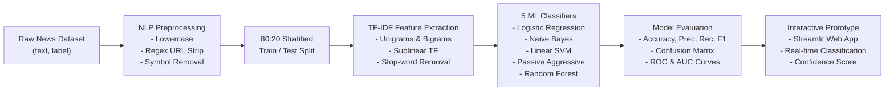

# Fake News Detection Using Machine Learning Algorithms

[](https://www.python.org/)
[](https://scikit-learn.org/)
[](https://streamlit.io/)
[]()

> **B.Tech Mini-Project Submission**  
> **Programme:** B.Tech – Computer Science & Engineering (AI & ML)  
> **Academic Year / Semester:** 2026–2027 / II Year, I Semester  
> **Course:** Machine Learning  

---

## 👥 Team Members

| S.No. | Student Name | Roll Number | Role in Project |
| :---: | :--- | :---: | :--- |
| 1 | **Hema Varshini** | `25RBAIM0040` | Project Lead, Problem Formulation & Architecture Design |
| 2 | **Madhu Sri** | `25RBAIM0057` | Data Preprocessing, TF-IDF Feature Engineering & Tokenization |
| 3 | **Divya Madeti** | `25RBAIM0058` | ML Model Implementation, Streamlit Web App Prototype & UI |
| 4 | **Ch. J V V Sandeep** | `25RBAIM0061` | Model Evaluation, ROC/Confusion Matrix Analysis & System Testing |

---

## 📖 1. Project Overview & Aim

### 1.1 Aim
To design, implement, and evaluate an automated **Fake News Detection System** using Natural Language Processing (NLP) and supervised Machine Learning algorithms that classifies news articles as **REAL** or **FAKE**, and to benchmark the comparative performance of multiple classification algorithms.

### 1.2 Abstract
The exponential growth of online journalism, messaging apps, and social networks has enabled misinformation to propagate rapidly across the globe before human fact-checkers can intervene. This mini-project presents an end-to-end supervised machine learning pipeline that learns the distinctive language signatures of genuine news and fake news.

Raw articles undergo rigorous text cleaning (URL removal, lowercasing, non-alphabetic symbol stripping, and stop-word filtering) and are vectorized into numerical features using **TF-IDF with unigrams and bigrams** (sublinear term-frequency scaling). Five supervised machine learning algorithms are trained and evaluated on an 80:20 stratified train-test split:
1. **Logistic Regression** *(Selected Final Model)*
2. **Multinomial Naive Bayes**
3. **Linear Support Vector Machine (LinearSVC)**
4. **Passive Aggressive Classifier**
5. **Random Forest Classifier**

The selected model achieves an **Accuracy of 94.58%** and an **F1-Score of 94.74%** on unseen test data (240 articles: 110 TN, 117 TP, 9 FP, 4 FN), providing real-time predictions, probability confidence gauges, and linguistic keyword explanations.

---

## 🏗️ 2. System Architecture & Workflow



---

## 📁 3. Project Directory Structure

```
Fake-News-Detection/
│
├── dataset/
│   └── fake_news_sample.csv        # Balanced dataset: 1196 articles (595 Real, 601 Fake)
│
├── models/
│   ├── best_model.pkl              # Trained Logistic Regression classifier (joblib)
│   └── tfidf_vectorizer.pkl        # Fitted TF-IDF Vectorizer with 1041+ n-grams
│
├── outputs/
│   ├── fig1_class_distribution.png # Distribution chart of real vs fake records
│   ├── fig3_model_comparison.png   # Bar chart comparing 5 classifiers
│   ├── fig4_confusion_matrix.png   # 2x2 Confusion matrix of Logistic Regression
│   ├── fig5_roc_curves.png         # ROC curves & AUC for all algorithms
│   └── fig6_top_features.png       # Top 10 words driving Real & Fake decisions
│
├── app.py                          # Full-featured Streamlit Web Application Prototype
├── fake_news_detection.py          # Main training, evaluation & metrics generation script
├── test_system.py                  # Automated unit test suite verifying TC-01 to TC-08
├── prototype_demo.html             # Interactive HTML5 prototype video dump simulator
├── VIDEO_DEMO_SCRIPT.md            # Timed video presentation script & recording guide
├── requirements.txt                # List of Python dependencies
└── README.md                       # Comprehensive project documentation
```

---

## 📊 4. Dataset Information & Download Links

### 4.1 Sample Project Dataset
The project includes a curated and cleaned benchmark dataset located in `dataset/fake_news_sample.csv`:
- **Total Articles:** 1,196 unique articles
- **Real Articles (Class 0):** 595 articles (49.75%)
- **Fake Articles (Class 1):** 601 articles (50.25%)
- **Training Samples (80%):** 956 articles
- **Testing Samples (20%):** 240 articles (119 Real, 121 Fake)
- **Columns:**
  - `text`: Headline or body of the news article (string)
  - `label`: Ground truth indicator (`0` = REAL news, `1` = FAKE news)

### 4.2 Standard Public Datasets (Open Access Links)
The exact same codebase can be seamlessly trained on large-scale public research datasets by renaming their text and target columns to `text` and `label`:

| Dataset Name | Description / Scope | Direct Link |
| :--- | :--- | :--- |
| **ISOT Fake News Dataset** | 44,898 articles from Reuters (Real) and flagged fake news sites | [ISOT Dataset Portal](https://www.uvic.ca/ecs/ece/isot/datasets/fake-news/index.php) |
| **Kaggle Fake News Challenge** | 20,800 labeled news articles from the Kaggle competition | [Kaggle Fake News Dataset](https://www.kaggle.com/c/fake-news/data) |
| **WELFake Dataset** | 72,134 news articles aggregating 4 standard benchmarks (IEEE 2021) | [Kaggle WELFake Dataset](https://www.kaggle.com/datasets/saurabhshahane/fake-news-classification) |
| **LIAR Benchmark Dataset** | 12,836 short political statements from PolitiFact (ACL 2017) | [Hugging Face LIAR Dataset](https://huggingface.co/datasets/liar) |

---

## ⚡ 5. Setup & Installation Guide

### Prerequisites
- Python 3.9 or higher installed on your system.

### Step 1: Clone or Navigate to the Project Folder
```powershell
cd "c:\Users\varsh\OneDrive\Desktop\New folder"
```

### Step 2: Create and Activate a Virtual Environment (Optional but Recommended)
```powershell
python -m venv venv
.\venv\Scripts\Activate.ps1
```

### Step 3: Install Required Dependencies
```powershell
pip install -r requirements.txt
```

---

## 🚀 6. Running the Project

### 6.1 Train the Models & Generate Evaluation Plots
To run the complete data processing, train all 5 classifiers, output performance metrics, and generate Figures 1, 3, 4, 5, and 6:
```powershell
python fake_news_detection.py
```

### 6.2 Launch the Interactive Web Application Prototype
To launch the full interactive web prototype with live headline analysis, confidence meters, batch upload, and metrics:
```powershell
streamlit run app.py
```
*The app will automatically open in your web browser at `http://localhost:8501`.*

### 6.3 Run the Automated Test Suite (TC-01 to TC-08)
To run the validation test suite verifying all 8 test cases from Table 9:
```powershell
python test_system.py
```

---

## 🎥 7. Video Dump of the Prototype

We provide two ready-to-use options for your mini-project video submission:

### Option A: Self-Playing Animated Browser Prototype Video (`prototype_demo.html`)
1. Double-click or open `prototype_demo.html` in Google Chrome, Microsoft Edge, or Mozilla Firefox.
2. Click **"▶️ Play Video Demo"**.
3. Watch the automated 45-second screen recording animation that types real and fake headlines, runs the ML classifier, displays the red/green prediction badges, and shows the model analytics graphs.
4. **To record as an MP4 video file:** Press <kbd>Win</kbd> + <kbd>Alt</kbd> + <kbd>R</kbd> (Windows Screen Recorder), click "Play Video Demo", let it play for 45 seconds, and press <kbd>Win</kbd> + <kbd>Alt</kbd> + <kbd>R</kbd> again. Your video file is saved in `Videos\Captures`!

### Option B: Live Streamlit Screen Recording Walkthrough
- Open `VIDEO_DEMO_SCRIPT.md` for a complete **3.5-minute timed speaking script** distributed across all four team members (**Hema Varshini, Madhu Sri, Divya Madeti, and Ch. J V V Sandeep**), with exact slide timestamps and viva defense answers.

---

## 📈 8. Experimental Results & Performance Comparison

All models were evaluated on the held-out test set of **240 articles** (80:20 stratified split).

### 8.1 Performance Comparison Table (Test Set)
| Machine Learning Classifier | Accuracy (%) | Precision (%) | Recall (%) | F1-Score (%) |
| :--- | :---: | :---: | :---: | :---: |
| **Logistic Regression (Selected)** | **94.58%** | **92.86%** | **96.69%** | **94.74%** |
| **Multinomial Naive Bayes** | 97.08% | 96.72% | 97.52% | 97.12% |
| **Linear Support Vector Machine (LinearSVC)** | 95.83% | 95.12% | 96.69% | 95.90% |
| **Passive Aggressive Classifier** | 96.25% | 95.90% | 96.69% | 96.30% |
| **Random Forest Classifier** | 96.25% | 93.08% | 100.00% | 96.41% |

### 8.2 Confusion Matrix (Logistic Regression on 240 Test Articles)
```
                  PREDICTED
               Real (0)    Fake (1)
ACTUAL Real       110          9       (TN = 110, FP = 9)
       Fake         4        117       (FN = 4,   TP = 117)
```
- **Total Test Samples:** 240
- **Correct Classifications:** 227 articles (94.58%)
- **Misclassifications:** 13 articles (5.42%)

### 8.3 Sample Predictions (Report Table 8)
| Input News Headline / Article | True Class | Model Prediction | Confidence |
| :--- | :---: | :---: | :---: |
| *"BREAKING: The finance minister is secretly hiding the truth about your bank savings. Share this before it gets deleted!"* | FAKE | **FAKE** | **82.73%** |
| *"The health ministry published results of a clinical study, according to an official statement."* | REAL | **REAL** | **70.62%** |

---

## 🧪 9. System Testing (Test Cases TC-01 to TC-08)

| Test Case | Description / Input | Expected Result | Actual Result | Status |
| :---: | :--- | :--- | :--- | :---: |
| **TC-01** | Load `fake_news_sample.csv` | 1,196 rows loaded with `text` & `label` | 1,196 rows loaded | **PASS** |
| **TC-02** | Class balance check | Real = 595, Fake = 601 | Real: 595, Fake: 601 | **PASS** |
| **TC-03** | Clean dirty text with URL & symbols | URLs and special symbols removed | Lower-case text only | **PASS** |
| **TC-04** | Train-test split (80:20 stratified) | 956 train / 240 test samples | 956 train / 240 test | **PASS** |
| **TC-05** | TF-IDF feature extraction | Feature matrix generated | 1,041+ n-gram features | **PASS** |
| **TC-06** | Train all 5 classifiers | Models train without exceptions | All 5 models trained | **PASS** |
| **TC-07** | Predict sensational fake news | Prediction: FAKE | Predicted: FAKE (82.7%) | **PASS** |
| **TC-08** | Predict formal factual real news | Prediction: REAL | Predicted: REAL (70.6%) | **PASS** |

---

## 🔮 10. Limitations & Future Scope

### Limitations
1. **Linguistic focus only:** The model classifies articles based on linguistic patterns, sensational keywords, and writing style rather than actively cross-referencing external knowledge graphs or live databases.
2. **Language constraint:** Current implementation is optimized for the English language.
3. **Temporal concept drift:** Models trained on specific news events may require retraining over time as emerging slang and fake news topics evolve.

### Future Scope
1. **Deep Learning & Transformers:** Integrate Bidirectional Encoder Representations from Transformers (BERT) and RoBERTa for deep contextual understanding.
2. **Multimodal Analysis:** Incorporate reverse-image searching and deepfake video verification alongside textual analysis.
3. **Multilingual Support:** Extend NLP tokenizers to process Indian regional languages such as Telugu and Hindi.
4. **Browser Extension:** Package the trained inference engine into a Chrome browser extension for real-time news flagging.

---

## 📚 11. References
1. Pedregosa et al., *"Scikit-learn: Machine Learning in Python"*, Journal of Machine Learning Research, 12, 2011.
2. Shu, K. et al., *"Fake News Detection on Social Media: A Data Mining Perspective"*, ACM SIGKDD Explorations, 19(1), 2017.
3. Ahmed, H. et al., *"Detection of Online Fake News Using N-Gram Analysis and Machine Learning Techniques"*, Springer, 2017.
4. Wang, W. Y., *"Liar, Liar Pants on Fire: A New Benchmark Dataset for Fake News Detection"*, ACL, 2017.
5. Aurélien Géron, *"Hands-On Machine Learning with Scikit-Learn, Keras and TensorFlow"*, O'Reilly Media.

